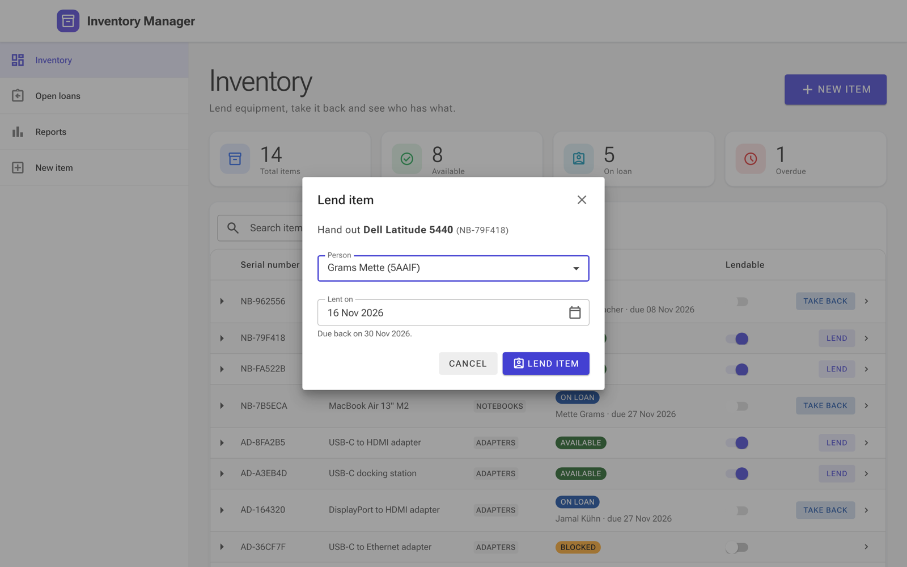
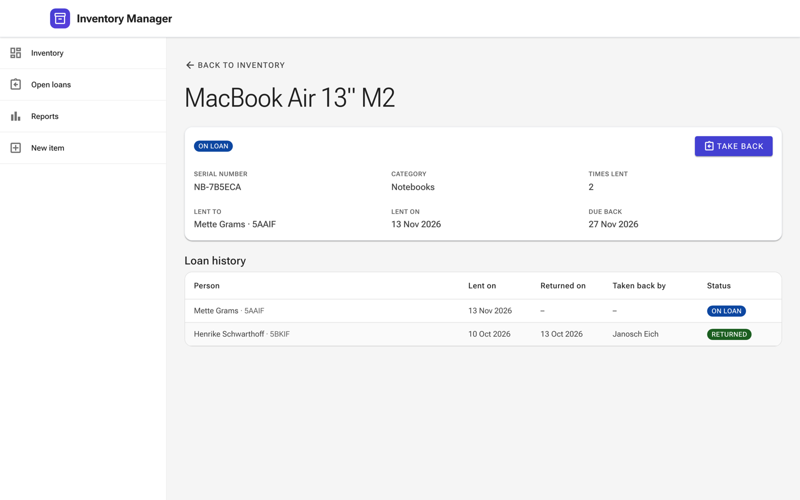
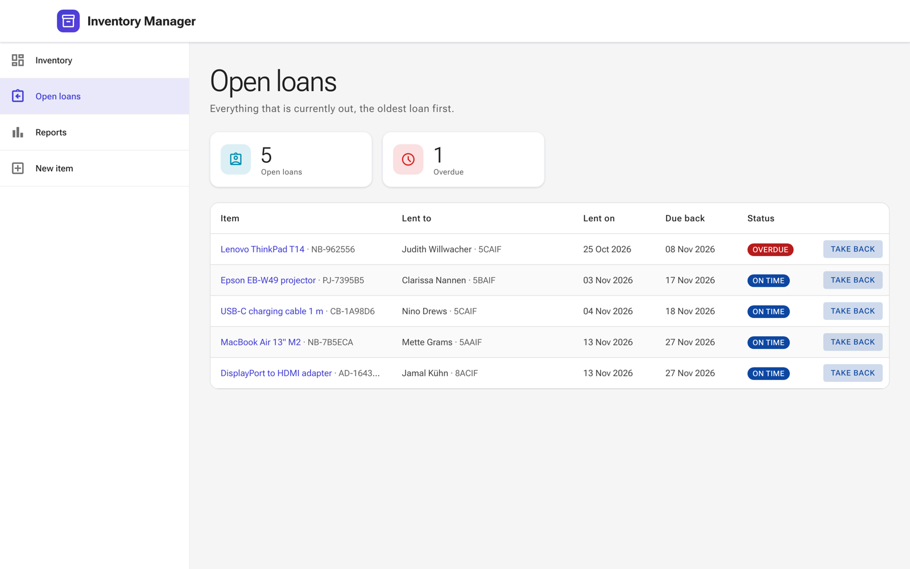
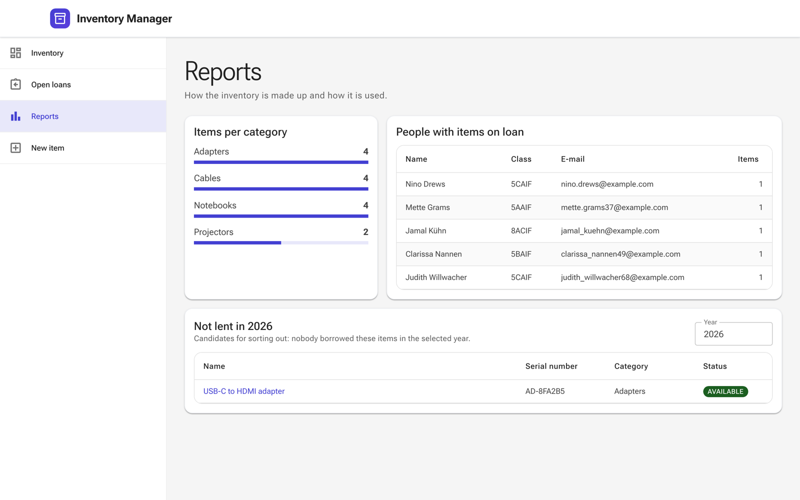
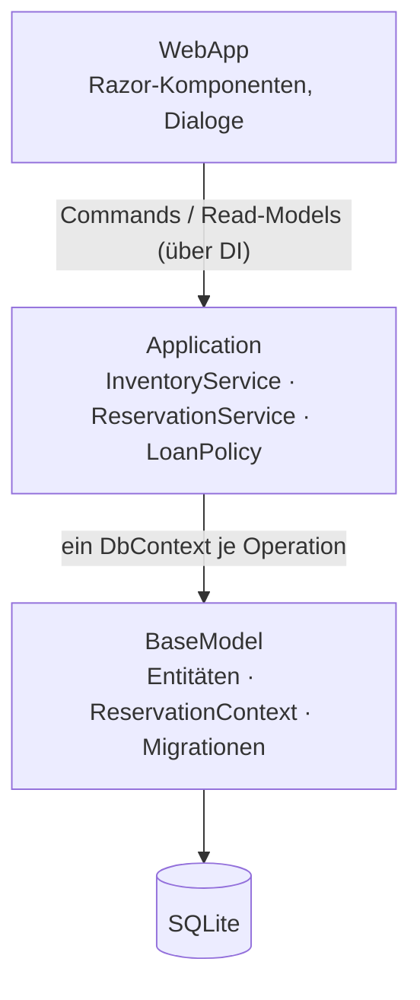

<div align="center">

# Inventory Manager

**Entleihsystem für Inventar: Geräte ausgeben, zurücknehmen und sehen, wer was hat.**
Blazor Server, EF Core und SQLite, mit Tests auf Service- und Browser-Ebene.

[](https://github.com/AdrianDeutsch/InventoryManager/actions/workflows/ci.yml)


</div>

---

## Überblick

Der Inventory Manager verwaltet ausleihbare Gegenstände einer Schule (Notebooks, Adapter, Kabel,
Beamer) und ihre Ausleihen. Mitarbeiter geben ein Gerät an eine Person aus, nehmen es wieder
zurück und sehen jederzeit, was verfügbar, verliehen, überfällig oder gesperrt ist.

Ausgangspunkt war eine Übungsvorlage mit Datenmodell und leeren Service-Methoden. Daraus ist
eine vollständige Anwendung geworden: Die Ausleihe hat Geschäftsregeln, die auch bei
gleichzeitigen Zugriffen halten, das Schema wird über Migrationen verwaltet, und jede Regel ist
durch einen Test belegt.

---

## Screenshots

| Übersicht | Ausleihen |
| --- | --- |
| [](docs/screenshots/01-overview.png) | [](docs/screenshots/02-lend-dialog.png) |
| Kennzahlen, Suche und Status je Gerät. Ausgeben und Zurücknehmen direkt aus der Liste. | Dialog mit Personensuche. Das Rückgabedatum ergibt sich aus der Leihfrist. |

| Detailansicht | Offene Ausleihen |
| --- | --- |
| [](docs/screenshots/03-detail.png) | [](docs/screenshots/04-open-loans.png) |
| Stammdaten, aktuelle Ausleihe und die gesamte Leihhistorie eines Geräts. | Alles, was gerade außer Haus ist, die älteste Ausleihe zuerst, Überfälliges markiert. |

| Auswertungen |
| --- |
| [](docs/screenshots/05-reports.png) |
| Geräte je Kategorie, Personen mit offenen Ausleihen, Geräte, die im gewählten Jahr nie verliehen wurden. |

---

## Funktionen

| Bereich | Funktion |
| --- | --- |
| Inventar | Liste mit Suche (Name, Seriennummer, Kategorie, Person), Sortierung und Paging |
| Ausleihe | Gerät an eine Person ausgeben, auch rückwirkend; das Gerät ist danach für andere gesperrt |
| Rückgabe | Gerät zurücknehmen, mit annehmendem Mitarbeiter und Zustand (in Ordnung oder beschädigt) |
| Sperren | Gerät von Hand sperren und freigeben, etwa für eine Reparatur |
| Überfällig | Ausleihen über der Leihfrist (Standard: 14 Tage, konfigurierbar) werden markiert und gezählt |
| Historie | Leihhistorie je Gerät, in der Übersicht aufklappbar und auf der Detailseite |
| Auswertungen | Geräte je Kategorie, Personen mit offenen Ausleihen, nie verliehene Geräte je Jahr |
| Anlegen | Neues Gerät mit Formularprüfung; Seriennummern sind eindeutig |

---

## Geschäftsregeln

Die Regeln stehen in der Service-Schicht. Wo es auf gleichzeitige Zugriffe ankommt, sichert
zusätzlich die Datenbank ab.

| Regel | Durchgesetzt in |
| --- | --- |
| Ein Gerät kann nur einmal gleichzeitig verliehen sein. | `ReservationService` und eindeutiger Teilindex auf offene Ausleihen |
| Ein gesperrtes Gerät kann nicht verliehen werden. | `ReservationService` |
| Ein verliehenes Gerät kann nicht freigegeben werden, bevor es zurück ist. | `InventoryService` |
| Eine Ausleihe beginnt nicht in der Zukunft und nicht vor der letzten Rückgabe des Geräts. | `ReservationService` |
| Eine Rückgabe liegt nicht vor dem Ausleihdatum und nicht in der Zukunft. | `ReservationService` |
| Eine Ausleihe kann nur einmal zurückgegeben werden. | `Reservation.Return`, Concurrency-Token auf dem Rückgabedatum |
| Ein beschädigt zurückgegebenes Gerät bleibt gesperrt, bis es jemand freigibt. | `ReservationService` |
| Seriennummern sind eindeutig, unabhängig von Groß- und Kleinschreibung. | `InventoryService` (speichert in Großbuchstaben) und eindeutiger Index |
| Personen und Geräte mit Ausleihen können nicht gelöscht werden. | Fremdschlüssel mit `Restrict` |

**Gleichzeitige Zugriffe:** Verleihen zwei Mitarbeiter dasselbe Gerät im selben Moment, bestehen
beide die Prüfung im Service. Der Teilindex (`UNIQUE … WHERE returnDate IS NULL`) lässt nur die
erste Ausleihe durch; die zweite Person bekommt eine verständliche Meldung statt einer zweiten
Ausleihe. Die Tests stellen genau diese Situation nach.

---

## Architektur

```
InventoryManager.sln
├── BaseModel/          Domänenmodell, DbContext, Migrationen, Demo-Daten
├── Application/        Services, Commands, Read-Models, Leihfrist-Regeln
├── WebApp/             Blazor-Server-Oberfläche (Radzen)
├── Application.Test/   Service-Tests gegen echtes SQLite
└── WebApp.E2ETest/     Browser-Tests mit Playwright
```



Entscheidungen und ihre Gründe:

- **Keine REST-Schicht.** Die Komponenten rufen die Services direkt über Dependency Injection
  auf. Bei Blazor Server läuft die Oberfläche ohnehin auf dem Server; eine HTTP-Schnittstelle
  dazwischen brächte nur Serialisierung und eine zweite Fehlerquelle.
- **`IDbContextFactory` statt eines Scoped-Contexts.** Ein DI-Scope lebt bei Blazor Server so
  lange wie der Browser-Tab. Ein Context pro Scope würde über Minuten dieselben Entitäten
  ausliefern und bei zwei überlappenden Klicks scheitern. Jede Service-Operation öffnet deshalb
  ihren eigenen kurzlebigen Context.
- **Schreiben und Lesen getrennt.** Änderungen laufen über Command-Records (`LendItemCmd`,
  `ReturnItemCmd`, …), Abfragen liefern unveränderliche Read-Models. Die Oberfläche bekommt nie
  eine EF-Entität in die Hand und formuliert keine Datenbankabfragen.
- **Fachliche Fehler haben einen eigenen Typ.** Eine verletzte Regel wirft eine
  `BusinessRuleException` mit einer Meldung für den Benutzer; die Oberfläche zeigt sie an.
  Technische Fehler gehen mit allen Details ins Log, der Benutzer bekommt nur einen neutralen
  Hinweis ([`TechnicalErrorNotifier.cs`](WebApp/Components/Shared/TechnicalErrorNotifier.cs)).
- **Die Uhr ist austauschbar.** „Heute“ und „überfällig“ kommen aus `LoanPolicy` mit
  injiziertem `TimeProvider`. Die Tests laufen mit festem Datum.
- **Kein Prerendering.** Die Anwendung ist ein internes Werkzeug. Ohne Prerendering lädt jede
  Seite ihre Daten einmal statt zweimal, und kein Button ist sichtbar, bevor er reagiert.

---

## Domänenmodell

```
Category 1───* InventoryItem 1───* Reservation *───1 Person
                                        │
                                        └──*───0..1 Staff   (nimmt die Rückgabe an)
```

| Entität | Kernfelder |
| --- | --- |
| `InventoryItem` | `SerialNumber` (eindeutig), `ItemName`, `Category`, `IsAvailable` |
| `Category` | `Text` |
| `Reservation` | `Person`, `InventoryItem`, `LoanDate`, `ReturnDate?`, `Status`, `AcceptedBy?` |
| `Person` | `FirstName`, `LastName`, `SchoolClass`, `Email`, `Phone` |
| `Staff` | `FirstName`, `LastName` |

Der Status einer Ausleihe ist ein Enum (`Issued`, `Returned`, `DamagedReturn`) und wird als Text
gespeichert. Er steuert Regeln im Code, deshalb liegt er nicht in einer Nachschlagetabelle.

Im Code heißt die Ausleihe `Reservation`. Der Name stammt aus der Vorlage und ist geblieben,
damit Entität, Tabelle und Service gleich heißen; in der Oberfläche steht durchgehend „Loan“.

---

## Tests

| Ebene | Projekt | Tests | Wogegen |
| --- | --- | --- | --- |
| Service und Datenbank | `Application.Test` | 80 | echtes SQLite (in-memory), Schema aus den Migrationen |
| Oberfläche | `WebApp.E2ETest` | 13 | die laufende Anwendung in Chromium (Playwright) |

**Service-Tests.** Die Services laufen gegen eine echte SQLite-Datenbank statt gegen einen
gemockten `DbContext`. Abfrage-Übersetzung, eindeutige Indizes und Concurrency-Token tragen einen
Teil der Regeln, und ein Mock würde genau diese Teile nicht ausführen. Jeder Test hat seine
eigene Datenbank und ein festes Datum.

- *Regeln:* jeder Eintrag der Tabelle oben, mit erlaubtem und abgelehntem Fall und den
  Grenzwerten (Rückgabe am Ausleihtag, fällig heute, 255 Zeichen).
- *Wettläufe:* Ein Interceptor führt direkt vor dem `SaveChanges` des Service den Schreibzugriff
  eines „zweiten Benutzers“ aus. So ist der Wettlauf bei jedem Lauf derselbe
  ([`ServiceTestBase.cs`](Application.Test/ServiceTestBase.cs)).
- *Datenbank-Garantien:* was die Datenbank auch ohne Service verhindert
  ([`DatabaseGuaranteeTests.cs`](Application.Test/DatabaseGuaranteeTests.cs)). Dazu gehört ein
  Test, der fehlschlägt, wenn das Modell ohne neue Migration geändert wurde.
- *Demo-Daten:* Die Startdaten müssen dieselben Regeln einhalten wie echte Daten.

**Browser-Tests.** Die Tests starten die Anwendung selbst auf einem freien Port, mit einer
eigenen Wegwerf-Datenbank, und bedienen sie über Page Objects: Gerät anlegen, verleihen,
zurücknehmen, beschädigte Rückgabe, Suche, Leihhistorie, Formularprüfung, Auswertungen. Schlägt ein Test fehl,
liegen Screenshot und Playwright-Trace in `WebApp.E2ETest/bin/<Konfiguration>/net10.0/artifacts/`.

**Abdeckung.** Die CI bricht ab, wenn die Zeilenabdeckung von Domänenmodell und Service-Schicht
unter 90 % fällt. Aktuell sind es 98 %.

---

## Schnellstart

Voraussetzung: [.NET SDK 10](https://dotnet.microsoft.com/download).

### Anwendung starten

```bash
dotnet run --project WebApp
```

Die Anwendung läuft unter **http://localhost:5080**. Beim ersten Start entsteht die Datenbank
`WebApp/inventory.db` mit Demo-Daten: 14 Geräte, 20 Personen und eine Leihhistorie relativ zum
heutigen Datum, darunter offene und überfällige Ausleihen. Zum Zurücksetzen die Datei löschen.

### Tests ausführen

```bash
# Service-Tests
dotnet test Application.Test

# Browser-Tests: einmalig den Browser installieren, dann ausführen
dotnet tool install --global Microsoft.Playwright.CLI
dotnet build WebApp.E2ETest
cd WebApp.E2ETest && playwright install chromium && cd ..
dotnet test WebApp.E2ETest
```

`HEADLESS=false dotnet test WebApp.E2ETest` zeigt den Browser während der Tests.

### Schema ändern

```bash
dotnet tool restore
dotnet ef migrations add <Name> --project BaseModel
```

Die Anwendung wendet offene Migrationen beim Start an.

---

## Konfiguration

[`WebApp/appsettings.json`](WebApp/appsettings.json):

| Schlüssel | Standard | Bedeutung |
| --- | --- | --- |
| `ConnectionStrings:Default` | `Data Source=inventory.db` | SQLite-Datei, relativ zum Projektordner der WebApp |
| `Loans:MaxLoanDays` | `14` | Leihfrist in Tagen; danach gilt eine Ausleihe als überfällig |
| `DemoData:SeedOnEmptyDatabase` | `true` | Leere Datenbank beim Start mit Demo-Daten füllen |

`/healthz` meldet, ob die Anwendung läuft.

---

## CI

[`.github/workflows/ci.yml`](.github/workflows/ci.yml) läuft bei jedem Push auf `main` und bei
jedem Pull Request, von schnell nach langsam: Build (Warnungen sind Fehler), Service-Tests, Abdeckungsgrenze,
Browser-Tests. Screenshots und Traces fehlgeschlagener Browser-Tests werden als Artefakt
aufbewahrt.

---

## Projektstruktur

```
InventoryManager/
├── BaseModel/
│   ├── Model/                         InventoryItem, Category, Reservation, ReservationStatus, Person, Staff
│   └── Infrastructure/
│       ├── ReservationContext.cs      Mapping, Indizes, Concurrency-Token
│       ├── Migrations/                EF-Core-Migrationen
│       └── DemoDataSeeder.cs          Startdaten (deterministisch, relativ zum Datum)
├── Application/
│   ├── Commands/                      AddInventoryItemCmd, UpdateAvailabilityCmd, LendItemCmd, ReturnItemCmd
│   ├── ReadModels/                    Read-Models und gemeinsame Abfragen
│   └── Services/                      InventoryService, ReservationService, LoanPolicy, Exceptions
├── Application.Test/                  Service-, Datenbank- und Seed-Tests (xUnit)
├── WebApp/
│   ├── Program.cs                     Host: Blazor, Radzen, DbContextFactory, Migration, Seed
│   └── Components/
│       ├── Pages/                     Übersicht, Detail, Anlegen, Offene Ausleihen, Auswertungen
│       ├── Shared/                    Dialoge (Ausleihen, Zurücknehmen), Status-Badge, Historie, Fehlermeldung
│       └── Layout/
├── WebApp.E2ETest/
│   ├── AppFixture.cs                  startet Anwendung und Browser
│   ├── Pages/                         Page Objects
│   └── *Tests.cs
└── .github/workflows/ci.yml
```

---

## Grenzen

- Keine Anmeldung und keine Rollen: Jeder mit Zugriff auf die Anwendung darf alles.
- Personen, Mitarbeiter und Kategorien kommen aus den Demo-Daten und sind nicht über die
  Oberfläche pflegbar.
- SQLite genügt für einen Standort. Für mehrere Server wäre ein Datenbankserver nötig. An
  SQLite gebunden sind dabei die Migrationen und die Erkennung des Fehlercodes für verletzte
  Eindeutigkeit ([`DbUpdateExceptionExtensions.cs`](BaseModel/Infrastructure/DbUpdateExceptionExtensions.cs)),
  nicht die Regeln in den Services.
- Die Oberfläche ist englisch.
