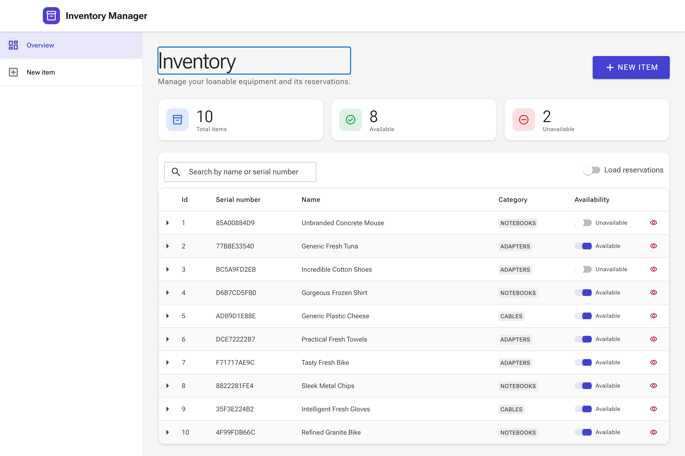
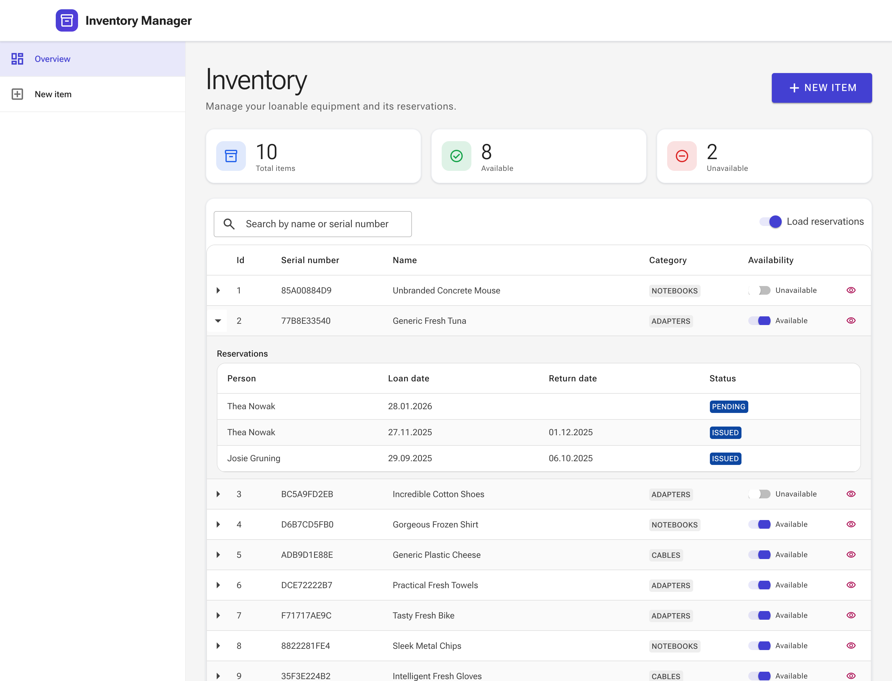
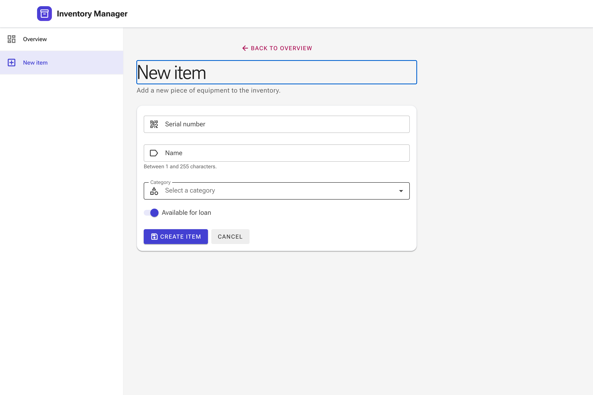

<div align="center">

# 📦 Inventory Manager

**Ein Entleihsystem für Inventar-Items, gebaut als interaktive Blazor-Server-App mit Radzen.**


-512BD4?logo=blazor&logoColor=white)


</div>

---

## 🎯 Überblick

Der **Inventory Manager** verwaltet ausleihbare Inventar-Gegenstände (z. B. Notebooks, Adapter,
Kabel) inklusive ihrer Reservierungen. Die Anwendung ist eine **Blazor-Server-App** im neuen
*Blazor-Web-App*-Modell (`InteractiveServer`): Die UI-Komponenten greifen **direkt über Dependency
Injection** auf die Service-Schicht zu – es gibt bewusst **keine HTTP-/REST-Zwischenschicht**.

Das Projekt entstand aus einer ursprünglich API-basierten Vorlage und wurde vollständig auf eine
direkt konsumierte Service-Architektur mit moderner Radzen-Oberfläche umgestellt.

---

## 🖼️ Screenshots

| Übersicht | Reservierungen |
| --- | --- |
| [](docs/screenshots/01-overview.png) | [](docs/screenshots/02-overview-reservations.png) |
| **Sortier- und durchsuchbares Grid** mit KPI-Kacheln und Verfügbarkeits-Switch je Zeile. | **Aufklappbare Detailzeile** mit den Reservierungen eines Items (Person, Ausleih-/Rückgabedatum, Status). |

| Detailansicht | Item anlegen |
| --- | --- |
| [](docs/screenshots/03-detail.png) | [](docs/screenshots/04-create.png) |
| **Stammdaten** eines Items in einer Card inkl. Verfügbarkeits-Badge. | **Validiertes Formular** zum Anlegen eines neuen Inventar-Items. |

---

## ✨ Features

| Bereich | Funktion |
| --- | --- |
| 📋 **Übersicht** | Alle Inventar-Items in einem sortier- und paginierbaren `RadzenDataGrid` |
| 🔄 **Reservierungen** | Pro Item optional nachladbar und als aufklappbare Detailzeile dargestellt (Person, Ausleih-/Rückgabedatum, Status) |
| 🟢 **Verfügbarkeit** | Direkt aus der Liste per Switch umschaltbar – mit optimistischem Update und Rollback bei Fehlern |
| 🔍 **Detailansicht** | Stammdaten eines Items übersichtlich in einer Card inkl. Verfügbarkeits-Badge |
| ➕ **Anlegen** | Formular mit clientseitiger Validierung (Pflichtfelder, 1–255 Zeichen, Kategorieauswahl) |
| 🔔 **Feedback** | Erfolgs- und Fehlermeldungen über Radzen-Notifications |
| 🛡️ **Robustheit** | Domänen-Exceptions führen nie zu Abstürzen, sondern zu verständlichem Nutzer-Feedback |
| 🧪 **Tests** | Eigenständige xUnit-Suite für die gesamte Geschäftslogik der Service-Schicht |

---

## 🧱 Architektur

Die Solution ist in drei produktive Projekte plus ein Test-Projekt gegliedert (Separation of
Concerns):

```
InventoryManager.sln
├── BaseModel/          # Domänenmodell + EF-Core-DbContext (ReservationContext)
├── Application/        # Service-Schicht: InventoryService & ReservationService + Commands/Exceptions
├── Application.Test/   # Eigenständige Unit-Tests für InventoryService
└── WebApp/             # ⭐ Blazor-Server-App (UI)
```

### Schichten

```
┌──────────────────────────────────────────────┐
│  WebApp – Blazor Components (Razor)            │
│  Overview · Detail · Create · Layout           │
└───────────────┬────────────────────────────────┘
                │  Dependency Injection (direkt)
┌───────────────▼────────────────────────────────┐
│  Application – Service-Schicht                 │
│  InventoryService  →  Commands / Exceptions    │
└───────────────┬────────────────────────────────┘
                │  EF Core
┌───────────────▼────────────────────────────────┐
│  BaseModel – ReservationContext → SQLite (mem) │
└────────────────────────────────────────────────┘
```

* **Keine REST-Schicht:** Komponenten konsumieren `InventoryService` ausschließlich über DI.
* **CQRS-Anklänge:** Schreiboperationen laufen über Command-Records (`AddInventoryItemCmd`,
  `UpdateAvailabilityCmd`); Lesezugriffe über die `IQueryable`-Oberfläche `InventoryItems`.
* **Domänen-Exceptions:** `InventoryServiceException` (Basis) und das spezialisierte
  `InventoryNotFoundException` trennen fachliche von technischen Fehlern.

---

## 🗂️ Domänenmodell

```
Category 1───* InventoryItem 1───* Reservation *───1 Person
                                        │
                                        ├──*───1 Status
                                        └──*───1 Staff   (optional, „accepted by“)
```

| Entität | Kernfelder |
| --- | --- |
| `InventoryItem` | `SerialNumber`, `ItemName`, `Category`, `IsAvailable`, `Reservations` |
| `Category` | `Text`, `InventoryItems` |
| `Reservation` | `Person`, `InventoryItem`, `LoanDate`, `Status`, `ReturnDate?`, `AcceptedBy?` |
| `Person` | `FirstName`, `LastName`, `SchoolClass`, `Email`, `Phone` |
| `Status` | `Text` (z. B. *Pending*, *Issued*, *Damaged return*) |
| `Staff` | `FirstName`, `LastName` |

Das Schema wird von `ReservationContext` per Convention konfiguriert (Tabellen-/Spaltennamen in
camelCase, `string`-Defaultlänge 255, `Restrict`-Löschverhalten). Beim Start in der Umgebung
`Development` wird die Datenbank über `Seed()` mit realistischen Beispieldaten (Bogus) befüllt.

---

## 🖥️ Die Oberfläche

| Route | Komponente | Beschreibung |
| --- | --- | --- |
| `/`, `/inventory` | `InventoryOverview.razor` | Liste aller Items, Reservierungen optional nachladen, Verfügbarkeit toggeln |
| `/inventory/{id}` | `InventoryDetail.razor` | Stammdaten eines Items |
| `/inventory/create` | `InventoryCreate.razor` | Neues Item anlegen (validiertes Formular) |

**Verwendete Radzen-Komponenten:** `RadzenDataGrid`, `RadzenSwitch`, `RadzenDropDown`,
`RadzenCard`, `RadzenBadge`, `RadzenNotification`, `RadzenLayout/Header/Body`, `RadzenButton`,
`RadzenFormField`, `RadzenAlert` u. a.

---

## ✅ Validierung & Fehlerbehandlung

* **Validierung** erfolgt vor jedem Service-Aufruf über `EditForm` + `DataAnnotationsValidator`
  auf Basis von [`InventoryItemFormModel`](WebApp/ViewModels/InventoryItemFormModel.cs):
  Pflichtfelder, Längenbegrenzung **1–255 Zeichen** und verpflichtende Kategorieauswahl.
  Es gibt **eine einzige Quelle der Wahrheit** (Data Annotations) – keine doppelten Validatoren.
* **Fehlerbehandlung:** Jeder Service-Aufruf ist gegen `InventoryServiceException` abgesichert
  (fängt durch Vererbung auch `InventoryNotFoundException`). Der Nutzer erhält eine klare
  Notification; beim Verfügbarkeits-Toggle wird der optimistische Wert bei Fehler
  **zurückgerollt**, sodass UI und Datenbank konsistent bleiben.

---

## 🚀 Schnellstart

### Voraussetzungen

* [.NET SDK 10.0](https://dotnet.microsoft.com/download) oder neuer
* Paketquelle `nuget.org` (Standard)

### Anwendung starten

```bash
# Aus dem Repository-Wurzelverzeichnis
dotnet run --project WebApp
```

Die App startet standardmäßig unter **http://localhost:5080**. In der Umgebung `Development`
(Default des Start-Profils) werden automatisch Beispieldaten geseedet.

### Tests ausführen

```bash
# Nur die Service-Tests
dotnet test Application.Test

# Alle Tests der Solution
dotnet test
```

### Komplette Solution bauen

```bash
dotnet build InventoryManager.sln
```

---

## 🧪 Tests

Die Test-Suite in `Application.Test` ist **vollständig eigenständig** und deckt die zentrale
Geschäftslogik des `InventoryService` ab – Erfolgs- **und** Fehlerpfade.

| Testklasse | Abgedeckt |
| --- | --- |
| `AddInventoryItemTests` | Persistenz + Kategorie-Verknüpfung; `InventoryServiceException` bei unbekannter Kategorie; kein Teil-Insert im Fehlerfall |
| `UpdateAvailabilityTests` | Toggeln in beide Richtungen + Persistenz; `InventoryNotFoundException` bei unbekannter Id |
| `InventoryItemsQueryTests` | Vollständige Liste; Eager Loading von Reservierungen inkl. Person; leere Reservierungs-Collection |

**Vorgehen:** xUnit mit echter **In-Memory-SQLite-Datenbank** statt eines DbContext-Mocks.
Der Service hängt an realer EF-Core-Query-Translation, Change-Tracking und `SaveChanges`-Semantik,
die ein Mock nicht originalgetreu abbilden kann. Eine geteilte, offen gehaltene Connection lässt
die In-Memory-DB über mehrere kurzlebige Contexts hinweg bestehen (einer zum Agieren, ein frischer
zum Verifizieren der Persistenz – unabhängig vom Change-Tracker). Alle Tests folgen dem
**Arrange-Act-Assert**-Muster.

```
Bestanden!  erfolgreich: 9, fehlgeschlagen: 0
```

---

## 🛠️ Tech-Stack

| Kategorie | Technologie |
| --- | --- |
| Framework | .NET 10 |
| UI | Blazor Server (InteractiveServer), Radzen.Blazor 10.4 |
| Persistenz | EF Core 10 + SQLite (in-memory) |
| Tests | xUnit, Microsoft.NET.Test.Sdk, coverlet |
| Beispieldaten | Bogus, CsvHelper |

---

## 📁 Projektstruktur

```
InventoryManager/
├── BaseModel/
│   ├── Model/                        # InventoryItem, Category, Reservation, Person, Status, Staff
│   └── Infrastructure/
│       └── ReservationContext.cs     # EF-Core-DbContext + Seed()
├── Application/
│   ├── Commands/                     # AddInventoryItemCmd, UpdateAvailabilityCmd
│   └── Services/                     # InventoryService, ReservationService + Domänen-Exceptions
├── Application.Test/                 # xUnit-Tests für InventoryService
└── WebApp/                           # ⭐ Blazor-Server-App
    ├── Program.cs                    # Host-Setup: Blazor, Radzen, EF, Seeding
    ├── Components/
    │   ├── App.razor                 # Root-Dokument inkl. Radzen-Assets
    │   ├── Routes.razor              # Router
    │   ├── _Imports.razor            # Globale Usings
    │   ├── Layout/
    │   │   └── MainLayout.razor      # Header/Body + RadzenComponents (Overlays)
    │   ├── Shared/
    │   │   └── StatCard.razor        # KPI-Kachel der Übersicht
    │   └── Pages/
    │       ├── InventoryOverview.razor  # Liste, Reservierungen, Verfügbarkeit
    │       ├── InventoryDetail.razor    # Stammdaten
    │       ├── InventoryCreate.razor    # Anlegen-Formular
    │       └── Error.razor              # Fehlerseite (Produktion)
    └── ViewModels/
        └── InventoryItemFormModel.cs    # Form-Modell mit Data Annotations
```

---

## 📝 Hinweise & Einschränkungen

* Die Datenbank läuft als **SQLite `:memory:`** über eine beim Start geöffnete, gemeinsame
  Connection. Daten bestehen daher nur für die Laufzeit des Prozesses. Für echten Mehrbenutzer-
  Betrieb wäre eine dateibasierte DB in Kombination mit `IDbContextFactory` (ein Context pro
  Operation) der nächste Ausbauschritt.
* `InventoryService` ist als vorgegebene Komponente unverändert übernommen; die App baut die
  gesamte UX rund um diese Service-Oberfläche auf.
</content>
